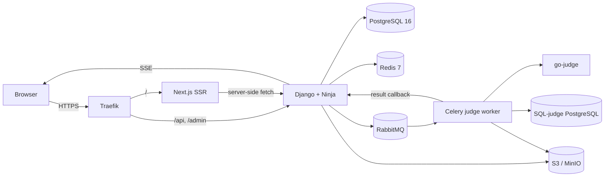
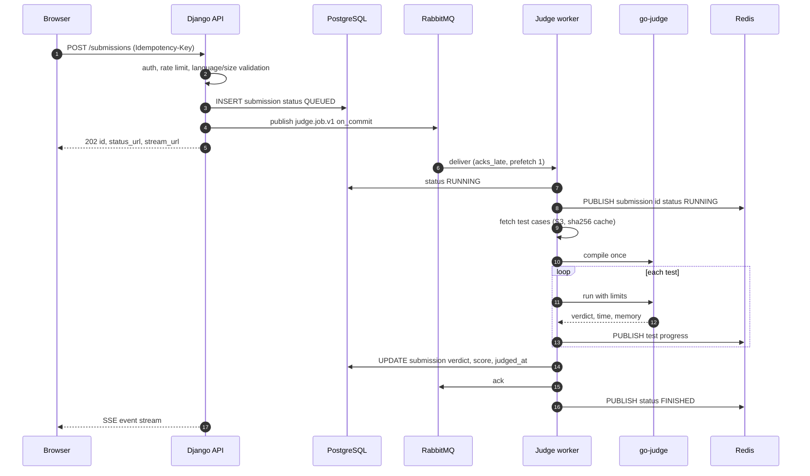
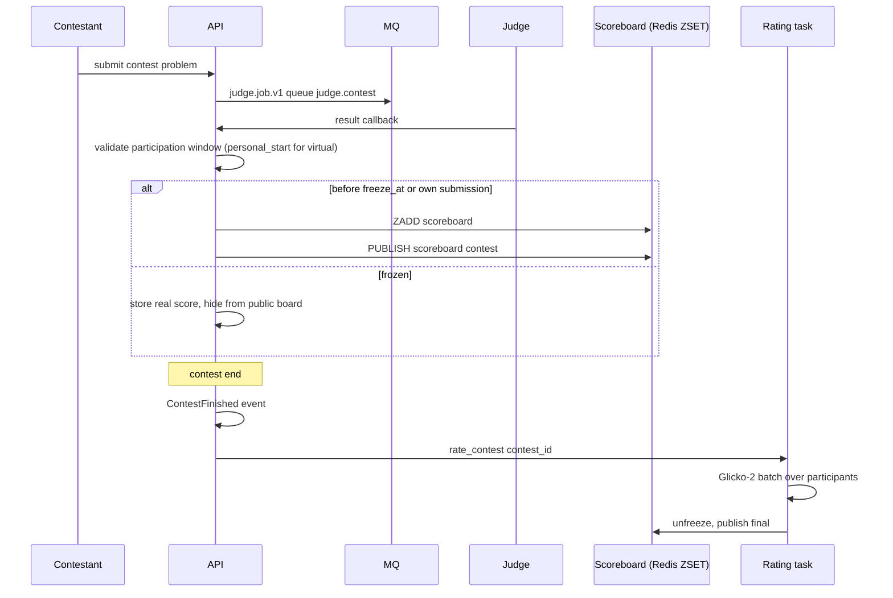
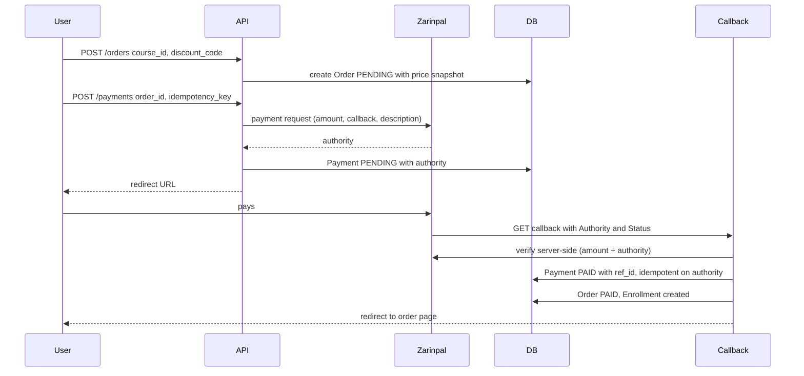
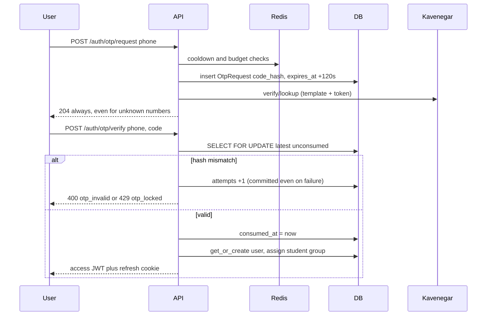

# Technical Design

## 1. Shape of the system

Two VMs. Everything stateful that matters (Postgres, Redis, RabbitMQ) lives on the app
server; the judge server holds go-judge and a throwaway Postgres. The judge server
accepts traffic only from the app server.

**Why a modular monolith.** Under 1,000 users, three developers, twelve weeks. Splitting
`commerce` from `catalog` into services buys distributed transactions and on-call load for
no benefit. Module boundaries are enforced by convention (service functions, domain
events) and reviewed in PRs, which is enough structure to extract a service later if
judging volume demands it.

**Why the judge is separate anyway.** It is the one component whose failure mode is
"arbitrary code". Keeping it off the database host means a sandbox escape does not start
next to the payments data.

## 2. Module boundaries

| Module | Owns | Publishes | Consumes |
|---|---|---|---|
| `accounts` | users, profiles, OTP, sessions | `UserRegistered` | none |
| `rbac` | groups, object capabilities | none | `UserRegistered` |
| `catalog` | tracks, courses, chapters, lessons, progress | `LessonCompleted` | `PaymentSucceeded` |
| `content` | MDX compile, lint, cached HTML | `ContentPublished` | none |
| `exercises` | quiz/code/sql problems, tests, hints | `ExerciseSolved` | none |
| `submissions` | submissions, test results | `SubmissionJudged` | `ExerciseSolved` |
| `judge_gateway` | job publish, result intake | `SubmissionQueued` | `SubmissionJudged` |
| `contests` | contests, participation, clarifications, scoreboard | `ContestFinished` | `SubmissionJudged` |
| `rating` | Glicko-2 state and history | `RatingUpdated` | `ContestFinished` |
| `gamification` | XP, streaks, badges, weekly board | `XpAwarded` | multiple |
| `community` | comments, forum, votes | none | none |
| `commerce` | orders, payments, discounts, enrollments | `PaymentSucceeded` | none |
| `certificates` | issuance, verification | none | `CourseCompleted` |

Rules:

1. No cross-module model imports. Import the *service* (`commerce.services.enroll`) or
   subscribe to an event.
2. Every event is dispatched after commit (`transaction.on_commit`) so subscribers never
   see uncommitted rows.
3. Read models that must join modules belong to the module that renders them and query by
   ID list.

## 3. Submission judging

Priority queues are ordered `judge.contest`, `judge.practice`, `judge.custom_run`,
`judge.rejudge`, each with a DLQ. Retries happen only for infrastructure faults (`SE`),
never for a wrong answer. Judging is idempotent: the same `submission_id` delivered twice
writes the same terminal state, and the second write is a no-op guarded by
`status != FINISHED`.

Scoreboard and submission status use Redis Pub/Sub. The API's SSE endpoint subscribes per
connection, so a 200-person contest costs 200 subscriptions on one process. That is
acceptable at this scale; a shared subscriber with fan-out is the documented upgrade path.

## 4. Contest scoring

ACM scoring is `(solved, penalty)` where penalty is minutes to accepted plus 20 per
rejected attempt on problems that were eventually accepted. IOI scoring takes the max
subtask score per problem. Freeze hides the public board only; contestants always see
their own verdicts.

## 5. Payment

Never trust the callback query string. Amount is re-checked against the stored order; a
mismatch is logged, the payment is marked `SUSPICIOUS`, and no enrollment is created. The
callback is idempotent on `authority`, so double delivery yields one enrollment.

## 6. OTP login

Failure responses are constant-shaped: whether the phone exists never changes the answer.
Failures commit their attempt counter; raising inside the transaction would roll it back
and give unlimited guesses.

## 7. Frontend rendering

- Public course, lesson-preview, and problem pages: SSR with `revalidate` (60s) and
  `generateMetadata` for OpenGraph. Paid lesson bodies are fetched with the user's
  session and never cached publicly.
- Auth-aware shells (`/dashboard`, `/learn/...`) are dynamic. The access token lives in an
  httpOnly cookie, so the browser cannot read it and server components proxy through
  Next's `cookies()`.
- Code editor, scoreboard, and live results are client components; everything else is
  server-rendered so the RTL layout is stable on first paint.
- No external CDN. Vazirmatn and JetBrains Mono are self-hosted through `next/font/local`.

## 8. Threat model summary

| Surface | Main risk | Mitigation |
|---|---|---|
| Sandbox | escape, fork bomb, network egress | namespaces + cgroups, no NIC, read-only root, tmpfs, go-judge seccomp |
| SQL judge | reading app data, DoS | separate instance, restricted role, statement_timeout, no extensions |
| Payments | forged callback, replay | server-side verify, amount check, idempotent authority |
| Auth | credential stuffing, token theft | throttles, Argon2, rotation with family revocation, CSRF double-submit |
| Content | XSS via MDX | allow-listed components, no raw HTML or script, server-side sanitize |
| Paid content | paywall bypass | authorization in the service layer; bodies never serialized for non-buyers |
